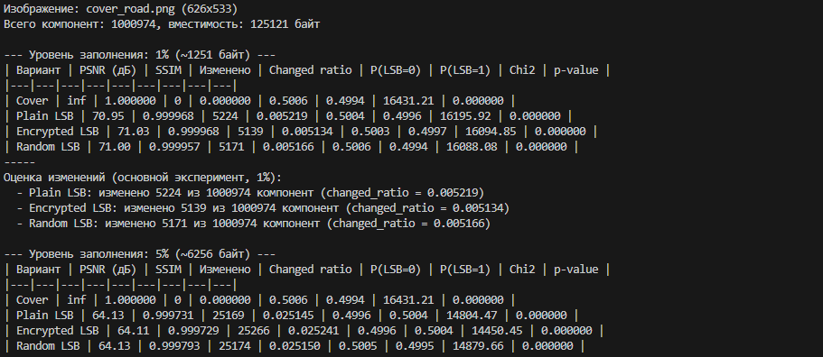
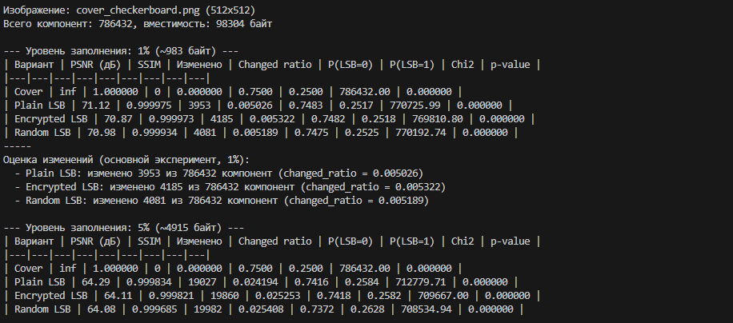
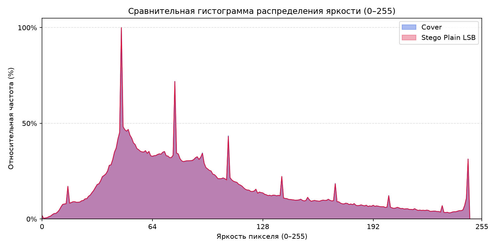

# Стеганография, шифрование и статистический анализ

## 1. Описание

В работе используются изображения:
- `cover_checkerboard.png` — шахматная структура;
- `cover_gradient.png` — плавный градиент;
- `cover_road.png` - дорога (собственное изображение).

## 2. Обычный LSB

Метод Plain LSB скрывает данные путём замены наименее значимого бита каждой цветовой компоненты (R, G, B) исходного изображения. Текст кодируется в UTF-8 и упаковывается в бинарный пакет. Изображение разворачивается в одномерный массив. Если размер пакета в битах превышает доступную емкость, программа завершается с ошибкой ValueError. Компоненты обходятся последовательно с начала изображения. Младший бит перезаписывается побитовой операцией (pixel & 0xFE) | bit, после чего изображение сохраняется в формате PNG. Из первых 32 компонент читается длина пакета, затем извлекаются остальные младшие биты, собираются в байты, проверяется контрольная сумма SHA-256 и восстанавливается исходный текст.

## 3. Гибридный вариант: шифрование + LSB

Реализована гибридная схема, объединяющая криптографию и псевдослучайное размещение битов. 
Из пароля с помощью функции PBKDF2-HMAC-SHA256 вырабатывается 256-битный ключ. Текст шифруется в режиме AES-256-GCM со случайным вектором инициализации nonce (12 байт). Режим GCM автоматически добавляет 16-байтовую вставку, которая при извлечении гарантирует проверку целостности данных и правильности пароля.
От пароля вычисляется хеш SHA-256, первые 8 байт которого используются как seed для инициализации генератора numpy.random.default_rng. Метод permutation() формирует воспроизводимую перестановку всех индексов компонент изображения без повторений, что исключает перезапись.
В эксперименте сравниваются два гибридных режима — Encrypted LSB (последовательная запись шифротекста с начала изображения) и Encrypted Random LSB (запись шифротекста по псевдослучайным позициям по всей площади изображения).

## 4. Статистическое сравнение

Для исходного изображения `cover_road.png` получила три итоговых изображения: 
 
- `stego_plain.png`;
- `stego_encrypted.png`;
- `stego_random.png`.

Если мы на них посмотрим, то не увидим изменений по сравнению с исходным изображением. Изменения в них мы можем заметить при вычислении метрик оценки качества. 

Для сравнения, я выбрала два изображения: `cover_road.png` и `cover_checkerboard.png`. На картинках приведены вычисленные значения метрик для каждого изображения, при разном значении полезной нагрузки (1% и 5%).
В файле `metrics.csv` приведены значения и для третей картинки, `cover_gradient.png`, но для сравнения мы ее брать не будем.

`cover_road.png`:

`cover_checkerboard.png`:

### Анализ:

1. PSNR показывает, насколько сильно изменился уровень яркости.
- `cover_road.png`: Разница между встраиваниями: при Encrypted LSB значение самое высокое (71.0262), а при Plain LSB и Encrypted Random LSB значения практически одинаковые (70.955 и 70.9993), но при этом, изменения визуально не заметны на всех трех изображениях.
SSIM показывает, насколько изменилась структура изображения. Это значение одинаковое при Plain LSB и Encrypted LSB (0.999968), а при Encrypted Random LSB чуть ниже (0.999957), эти значения близки к 1, что говорит о том, что структура изображения практически не изменилась.
- `cover_checkerboard.png`: при Plain LSB значение самое высокое (71.1181), а при Encrypted LSB и Encrypted Random LSB значения практически одинаковые (70.8705 и 70.9797), но при этом, изменения визуально не заметны на всех трех изображениях.
SSIM примерно одинаково при Plain LSB и Encrypted LSB (0.999975 и 0.999973), а при Encrypted Random LSB значение чуть ниже (0.999934), тут значения все так же близки к 1, что говорит о том, что структура изображения практически не изменилась.
Различия между оригиналом и зашифрованными изображениями неразличимы для глаза и проявляются только на карте разности.
Для двух изображений все три метода обеспечивают высокую визуальную незаметность, судя по PSNR и SSIM, различия между методами минимальны и не влияют на визуальное качество. У Encrypted Random LSB чуть меньший SSIM, чем у двух других методов, но это связано с распределением изменений по всему изображению, а не с ухудшением качества.

2. Доля измененных компонент показывает, какая часть изображения была затронута при встраивании данных.
- `cover_road.png`: При Encrypted LSB и Encrypted Random LSB (5139, changed_ratio = 0.005134 и 5171, changed_ratio = 0.005166) количество пикселей, которые изменили младший бит примерно одинаково, а при Plain LSB это значение чуть выше (5224, changed_ratio = 0.005219), этот метод изменяет больше компонент по сравнению с остальными. Все методы влияют на изображение примерно одинаково, различия в доле изменений незначительные.
- `cover_checkerboard.png`: При Plain LSB количество измененных компонент минимально по сравнению с другими методами (3953, changed_ratio = 0.005026), у Encrypted Random LSB (4081, changed_ratio = 0.005189), а у Encrypted LSB количество измененных компонент максимально (4185, changed_ratio = 0.005322). На этом изображении различия между методами чуть заметнее, но все значения остаются очень близкими, разница в changed_ratio не значительная.
Различия между методами минимальны и не влияют на визуальное качество. Encrypted LSB и Encrypted Random LSB обычно изменяют чуть больше компонент из-за служебных заголовков, но это не влияет на ухудшение изображения. 

3. P(LSB=0) и P(LSB=1) показывают распределение младших битов (LSB) во всём изображении после встраивания.
- `cover_road.png`: При Encrypted Random LSB значения наиболее схожи со значениями у исходного изображения (0.5006 и 0.4994), то есть распределение практически не изменилось, чуть сильнее значения отличаются у Plain LSB (0.5004 и 0.4996), небольшие расхождения из-за особенностей данных, а наиболее большая разница с исходным изображением у Encrypted LSB (0.5003 и 0.4997), этот метод легче обнаружить из-за расхождений по сравнению с распределением у исходного изображения. Encrypted Random LSB очень близко к распределение LSB на исходном изображении, что затрудняет статистическое обнаружение этого метода по сравнению с остальными.
- `cover_checkerboard.png`: У исходного изображения распределение отличается от распределения у `cover_road.png` (0.75 и 0.25). У Plain LSB (0.7483 и 0.2517) и у Encrypted LSB (0.7482 и 0.2518) распределение практически одинаковое, а у Encrypted Random LSB (0.7475 и 0.2525) чуть-чуть отличается. Распределения при всех трех методах близки к распределению у исходного изображения, но можно сказать, что при применении Encrypted Random LSB, этот метод легче обнаружить из-за бОльших расхождений с исходным распределением, чем при Plain LSB и Encrypted LSB.
`cover_checkerboard.png` - это искусственное изображение, все три метода для него практически сохранили исходную структуру, но Encrypted Random LSB чуть-чуть выбился, а `cover_road.png` более близко к естественному изображению и там различия между методами чуть более заметны. Но в обоих случаях различия между методами минимальны, и все три метода обеспечивают высокую статистическую скрытность.

4. χ² позволяет оценить, насколько встраивание данных изменило статистическую структуру младших битов изображения.
- `cover_road.png`: Самое большое значение у метода Plain LSB (16195.92), чуть меньше у Encrypted LSB (16094.85) и самое наименьшее у Encrypted Random LSB (16088.08). При этом у всех методов значение p-value (0.0), так как 90% пикселей изображения не изменялись. Encrypted Random LSB минимально изменяет статистику младших битов по сравнению с остальными методами.
- `cover_checkerboard.png`: Самое большое значение у метода Plain LSB (770725.99), чуть меньше у Encrypted Random LSB (770192.74) и самое наименьшее у Encrypted LSB (769810.8). При этом у всех методов значение p-value (0.0), так как 90% пикселей изображения не изменялись. Encrypted LSB минимально изменяет статистику младших битов по сравнению с остальными методами.
Есть различия между методами: выбор метода влияет на статистическую структуру младших битов. При выборе Encrypted Random LSB для более естественных изображений, обнаружить наличие скрытых данных будет сложнее. А для синтетических изображений, если выбрать Encrypted LSB, то будет сложнее обнаружить скрытые данные (чем ниже значение χ², тем меньше изменений в статистике, тем сложнее обнаружить скрытые данные).

5. Влияние объема данных. Если мы увеличим уровень заполнения в пять раз, то сможем заметить, что метрики заметно изменились по сравнению с низкой нагрузкой (это мы уже будем оценивать только для `cover_road.png`):
- PSNR: значения стали примерно одинаковыми у всех трех методов, но они уменьшились, по сравнению с основным экспериментом (Plain LSB (64.1264), Encrypted LSB (64.1097), Encrypted Random LSB (64.1255)), но все методы сохраняют визуальную незаметность;
- changed_ratio: (Plain LSB (0.025145), Encrypted LSB (0.025241), Encrypted Random LSB (0.02515)), различия между методами минимальные, но доля измененных данных растет, количество измененных данных тоже выросло в 5 раз по сравнению с минимальной нагрузкой (1%);
- χ²: (Plain LSB (14804.47), Encrypted LSB (14450.45), Encrypted Random LSB (14879.66)), меньше всего изменений при применении Encrypted LSB, то есть при этом методе обнаружить наличие скрытых данных будет сложнее;
- p-value: все также остается равным (0.0), так как даже при увеличении измененных пикселей в 5 раз (25169, 25174, 25266) не превышает даже половины от всех пикселей изображения (125121). При таких значениях вероятности обнаружить стенограмму тяжело.
Увеличение объема данных ухудшает метрики, но визуально изменения все так же остаются незаметными. Encrypted Random LSB все так же показывает значения лучше, чем два других метода и при большем объёме данных.

## 5. Визуализация

Карта разности:

Гистограмма:

## 6. Вывод

Таким образом, можно сделать вывод, что:

- Plain LSB — простейший и быстрый метод, но даёт наибольший статистический след, изменения находятся в одной части изображения.
- Encrypted LSB — обеспечивает криптографическую защиту и равномерное распределение бит, но изменения также сосредоточены в одной части изображения.
- Encrypted Random LSB — сочетает шифрование, контроль целостности и псевдослучайное распределение изменений, что минимизирует локальную статистическую заметность и повышает устойчивость к анализу, изменения находятся по всей площади изображения.

Для скрытия информации оптимальным является метод Encrypted Random LSB. Он одновременно обеспечивает криптографическую защиту и контроль целостности данных (PBKDF2 + AES-GCM) и снижает локальную статистическую заметность за счёт псевдослучайного распределения изменений по контейнеру.
