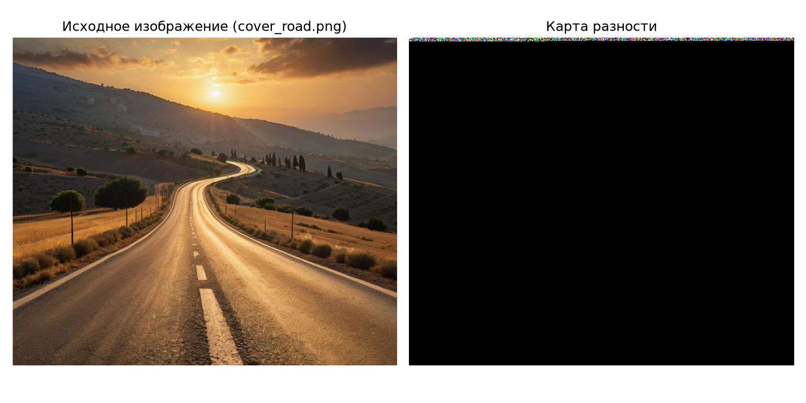
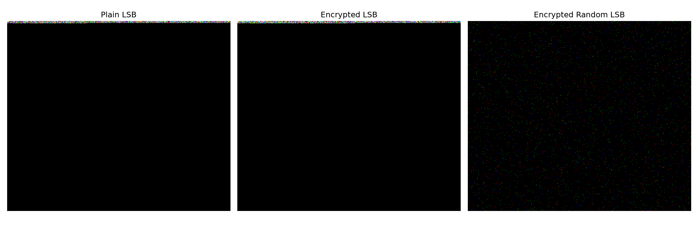

# Стеганография, шифрование и статистический анализ

## 1. Описание

В работе используются изображения:
- `cover_checkerboard.png` — шахматная структура;
- `cover_gradient.png` — плавный градиент;
- `cover_road.png` - дорога (собственное изображение).

## 2. Обычный LSB

Метод Plain LSB скрывает данные путём замены наименее значимого бита каждой цветовой компоненты (R, G, B) исходного изображения. Текст кодируется в UTF-8 и упаковывается в бинарный пакет. Изображение разворачивается в одномерный массив. Если размер пакета в битах превышает доступную емкость, программа завершается с ошибкой ValueError. Компоненты обходятся последовательно с начала изображения. Младший бит перезаписывается побитовой операцией (pixel & 0xFE) | bit, после чего изображение сохраняется в формате PNG. Из первых 32 компонент читается длина пакета, затем извлекаются остальные младшие биты, собираются в байты, проверяется контрольная сумма SHA-256 и восстанавливается исходный текст.

## 3. Гибридный вариант: шифрование + LSB

Реализована гибридная схема, объединяющая криптографию и псевдослучайное размещение битов. 
Из пароля с помощью функции PBKDF2-HMAC-SHA256 вырабатывается 256-битный ключ. Текст шифруется в режиме AES-256-GCM со случайным вектором инициализации nonce (12 байт). Режим GCM автоматически добавляет 16-байтовую вставку, которая при извлечении гарантирует проверку целостности данных и правильности пароля.
От пароля вычисляется хеш SHA-256, первые 8 байт которого используются как seed для инициализации генератора numpy.random.default_rng. Метод permutation() формирует воспроизводимую перестановку всех индексов компонент изображения без повторений, что исключает перезапись.
В эксперименте сравниваются два гибридных режима — Encrypted LSB (последовательная запись шифротекста с начала изображения) и Encrypted Random LSB (запись шифротекста по псевдослучайным позициям по всей площади изображения).

## 4. Статистическое сравнение

Для исходного изображения `cover_road.png` получила три итоговых изображения: 
 
- `stego_plain.png`;
- `stego_encrypted.png`;
- `stego_random.png`.

И два варианта полезной нагрузки:

Всего компонент: 1000974, вместимость: 125121 байт

## 5. Визуализация

Карта разности:

Гистограмма:

## 6. Итоговое сравнение. Анализ

Все три метода обеспечивают визуальную скрытность (PSNR ~71 при 1% заполнении и ~64,1 при 5%, SSIM > 0,9997). Различия между оригиналами и зашифрованными изображениями неразличимы для глаза и проявляются только на карте разности. При любом методе изменяется примерно половина от числа задействованных компонент (changed_ratio ≈ 0,5% при 1% заполнении и ≈ 2,5% при 5%), так как в половине случаев исходный младший бит уже совпадает с битом сообщения. У зашифрованных вариантов изменений незначительно больше из-за служебных заголовков (salt, nonce, GCM tag).

Шифрование AES-256-GCM не только защищает конфиденциальность текста, но и формирует равномерный поток битов с высокой энтропией. Благодаря этому зашифрованные методы сохраняют исходный баланс P(LSB=0) / P(LSB=1) (0,5004 / 0,4996 при 1%), у Plain LSB изменение (до 0,5032 / 0,4968 при 5%) из-за особенностей кодировки UTF-8.

Доля изменений растёт пропорционально объёму данных, а распределение LSB у зашифрованных методов ближе к равномерному.

У Plain LSB и Encrypted LSB все изменения видны в первых строках изображения. Encrypted Random LSB распределяет биты по всей площади изображения, сохраняя статистику p-value χ² ближе к исходному изображению (14795.45 при 1%, 14482.27 при 5%) и обеспечивая наивысший показатель структурного сходства SSIM (0,999793), также это снижает локальную статистическую заметность и повышает SSIM.

Для практического сокрытия информации оптимальным является гибридный метод Encrypted Random LSB, так как он одновременно обеспечивает криптографическую защиту и контроль целостности данных (PBKDF2 + AES-GCM) и снижает локальную статистическую заметность за счёт псевдослучайного распределения изменений по контейнеру.
